# DriveHub - Project Viva Evaluation Master Guide & Class Diagram
**Course:** SE1020 - Object-Oriented Programming (SLIIT)  
**Project:** DriveHub – Vehicle Rental Service Platform  
**Target Audience:** Member 01 & Member 02

---

## 1. Complete UML Class Diagram

This diagram represents the entire backend Java architecture implemented in the project. Print or export this diagram to bring to the viva examination.

```mermaid
classDiagram
    %% Inheritance Hierarchy: Member 1 (Fleet Management)
    class Vehicle {
        <<abstract>>
        #String vehicleId
        #String makeModel
        #double dailyRate
        #String category
        #String fuelType
        #String transmission
        #int seatingCapacity
        #String imageUrl
        #boolean available
        +Vehicle()
        +Vehicle(vehicleId, makeModel, dailyRate, category, fuelType, transmission, seatingCapacity, imageUrl, available)
        +getVehicleId() String
        +setVehicleId(String) void
        +getMakeModel() String
        +getDailyRate() double
        +isAvailable() boolean
        +setAvailable(boolean) void
        +calculateDailyRentalRate()* double
        +getVehicleSpecs()* String
        +toDataString()* String
    }

    class CarVehicle {
        -int trunkCapacityLitres
        -double securityDeposit
        -boolean hasAutopilot
        +CarVehicle()
        +CarVehicle(vehicleId, makeModel, dailyRate, fuelType, transmission, seatingCapacity, imageUrl, available, trunk, deposit, autopilot)
        +calculateDailyRentalRate() double
        +getVehicleSpecs() String
        +toDataString() String
        +getTrunkCapacityLitres() int
        +getSecurityDeposit() double
        +isHasAutopilot() boolean
    }

    class VanCommercialVehicle {
        -int cargoPayloadKg
        -double commercialPermitFee
        -int towingCapacityKg
        +VanCommercialVehicle()
        +VanCommercialVehicle(vehicleId, makeModel, dailyRate, fuelType, transmission, seatingCapacity, imageUrl, available, payload, permitFee, towing)
        +calculateDailyRentalRate() double
        +getVehicleSpecs() String
        +toDataString() String
        +getCargoPayloadKg() int
        +getCommercialPermitFee() double
        +getTowingCapacityKg() int
    }

    Vehicle <|-- CarVehicle : Inheritance (extends)
    Vehicle <|-- VanCommercialVehicle : Inheritance (extends)

    %% Inheritance Hierarchy: Member 2 (Rental Reservations)
    class RentalReservation {
        <<abstract>>
        #String reservationId
        #String customerName
        #String customerEmail
        #String customerPhone
        #String vehicleId
        #String pickupDate
        #String returnDate
        #int rentalDays
        #String rentalType
        #String status
        +RentalReservation()
        +RentalReservation(resId, name, email, phone, vehId, pickup, return, days, type, status)
        +getReservationId() String
        +getStatus() String
        +setStatus(String) void
        +canBeCancelled() boolean
        +calculateTotalAmount(double vehicleBaseRate)* double
        +getRentalSummary()* String
        +toDataString()* String
    }

    class SelfDriveReservation {
        -String driverLicenseNumber
        -String mileagePackage
        -String insuranceTier
        +SelfDriveReservation()
        +SelfDriveReservation(...)
        +calculateTotalAmount(double vehicleBaseRate) double
        +getRentalSummary() String
        +toDataString() String
        +getDriverLicenseNumber() String
        +getInsuranceTier() String
    }

    class ChauffeurDrivenReservation {
        -String pickupLocation
        -double driverDailyFee
        -String tripItineraryNotes
        +ChauffeurDrivenReservation()
        +ChauffeurDrivenReservation(...)
        +calculateTotalAmount(double vehicleBaseRate) double
        +getRentalSummary() String
        +toDataString() String
        +getPickupLocation() String
        +getDriverDailyFee() double
    }

    RentalReservation <|-- SelfDriveReservation : Inheritance (extends)
    RentalReservation <|-- ChauffeurDrivenReservation : Inheritance (extends)

    %% Data Access Layer (File Handling)
    class FileUtil {
        <<utility>>
        +DATA_DIRECTORY : String
        +resolveFilePath(ServletContext, String fileName) String
        +readAllLines(String absolutePath) List~String~
        +writeAllLines(String absolutePath, List~String~) boolean
        +appendLine(String absolutePath, String) boolean
    }

    class VehicleDAO {
        -String filePath
        +VehicleDAO(String filePath)
        +getAllVehicles() List~Vehicle~
        +getVehicleById(String id) Vehicle
        +addVehicle(Vehicle v) boolean
        +updateVehicle(Vehicle v) boolean
        +deleteVehicle(String id) boolean
        +searchVehicles(String keyword, String cat, String trans) List~Vehicle~
        -parseVehicle(String line) Vehicle
    }

    class RentalDAO {
        -String filePath
        +RentalDAO(String filePath)
        +getAllReservations() List~RentalReservation~
        +getReservationById(String id) RentalReservation
        +addReservation(RentalReservation r) boolean
        +updateReservation(RentalReservation r) boolean
        +deleteReservation(String id) boolean
        +updateStatus(String resId, String newStatus) boolean
        +searchReservations(String query) List~RentalReservation~
        -parseReservation(String line) RentalReservation
    }

    %% Controller / Servlet Layer
    class VehicleServlet {
        -VehicleDAO vehicleDAO
        +init() void
        #doGet(HttpServletRequest, HttpServletResponse) void
        #doPost(HttpServletRequest, HttpServletResponse) void
        -listVehicles(request, response) void
        -searchVehicles(request, response) void
        -manageVehicles(request, response) void
        -insertVehicle(request, response) void
        -updateVehicle(request, response) void
        -deleteVehicle(request, response) void
    }

    class RentalServlet {
        -RentalDAO rentalDAO
        -VehicleDAO vehicleDAO
        +init() void
        #doGet(HttpServletRequest, HttpServletResponse) void
        #doPost(HttpServletRequest, HttpServletResponse) void
        -listRentals(request, response) void
        -showBookingForm(request, response) void
        -createReservation(request, response) void
        -trackReservation(request, response) void
        -updateReservation(request, response) void
        -deleteReservation(request, response) void
    }

    %% Associations & Dependencies
    VehicleDAO ..> FileUtil : uses
    RentalDAO ..> FileUtil : uses
    VehicleDAO --> Vehicle : manages
    RentalDAO --> RentalReservation : manages

    VehicleServlet --> VehicleDAO : delegates CRUD to
    RentalServlet --> RentalDAO : delegates CRUD to
    RentalServlet --> VehicleDAO : looks up vehicles with
```



---

## 2. Member 01: Fleet Management & Vehicle Models

### Classes Owned
1. `com.drivehub.model.Vehicle.java` (Abstract Base Class)
2. `com.drivehub.model.CarVehicle.java` (Subclass)
3. `com.drivehub.model.VanCommercialVehicle.java` (Subclass)
4. `com.drivehub.dao.VehicleDAO.java` (Data Access Object / File I/O)
5. `com.drivehub.servlet.VehicleServlet.java` (HTTP Controller)

### OOP Concepts Demonstrated
* **Encapsulation:** All attributes are `private` or `protected`. Public getters and setters enforce data validation.
* **Inheritance:** `CarVehicle` and `VanCommercialVehicle` extend abstract `Vehicle` using `super(...)` constructors.
* **Polymorphism:** 
  - `calculateDailyRentalRate()`:
    - In `CarVehicle`: If `hasAutopilot == true`, adds `LKR 5,000.00/day` to `dailyRate`.
    - In `VanCommercialVehicle`: Adds commercial permit fee and heavy payload surcharge (`LKR 4,500.00`) to `dailyRate`.
  - `getVehicleSpecs()`: Formats distinct specialized attributes depending on whether it is a passenger car or cargo van.
* **Abstraction:** `Vehicle` cannot be instantiated directly (`new Vehicle(...)` is illegal). It defines the contract for all physical transport.

### Critical File I/O Code Explained
```java
// Inside VehicleDAO.java
public List<Vehicle> getAllVehicles() {
    List<Vehicle> list = new ArrayList<>();
    // try-with-resources guarantees file streams close cleanly, preventing memory leaks
    try (BufferedReader reader = new BufferedReader(new FileReader(filePath))) {
        String line;
        while ((line = reader.readLine()) != null) {
            line = line.trim();
            if (line.isEmpty() || line.startsWith("#")) continue;
            Vehicle v = parseVehicle(line); // parses CSV values: VEH101,Mercedes...
            if (v != null) list.add(v);
        }
    } catch (IOException e) {
        e.printStackTrace();
    }
    return list;
}
```

### Top 5 Viva Questions & Verbatim Answers for Member 01

#### Q1: "Why did you make `Vehicle` an abstract class instead of a regular class?"
> **Answer:** "Because a generic vehicle does not exist in our business domain without specific attributes. A vehicle must either be a passenger car or a commercial transport van. By making `Vehicle` abstract, we prevent invalid instantiations while establishing a common contract (`calculateDailyRentalRate()`, `getVehicleSpecs()`) that all concrete vehicles must implement."

#### Q2: "Show me where polymorphism is implemented in your fleet code."
> **Answer:** "In `Vehicle.java`, `calculateDailyRentalRate()` is declared as an abstract method. In `CarVehicle`, it calculates the price taking autonomous autopilot into account:
> ```java
> double techSurcharge = hasAutopilot ? 5000.00 : 0.00;
> return getDailyRate() + techSurcharge;
> ```
> In `VanCommercialVehicle`, it calculates the rate factoring in the commercial road permit and heavy cargo payload:
> ```java
> double payloadSurcharge = (cargoPayloadKg > 1500) ? 4500.00 : 0.00;
> return getDailyRate() + commercialPermitFee + payloadSurcharge;
> ```
> When the JSP displays the catalog, it calls `v.calculateDailyRentalRate()` on a `Vehicle` reference without knowing the exact subtype, and Java executes the appropriate subclass implementation at runtime."

#### Q3: "How does your `VehicleDAO` update or delete a record in `vehicles.txt` without a SQL database?"
> **Answer:** "Since text files do not support random in-place row mutations, `VehicleDAO` reads all lines into memory into a `List<Vehicle>`, locates the matching record by `vehicleId`, applies the mutation (or omits it for deletion), and rewrites the entire file using `BufferedWriter` with `FileWriter(file, false)` (overwriting mode)."

#### Q4: "What happens if a user submits invalid numbers in the Add Vehicle form?"
> **Answer:** "In `VehicleServlet.java`, the incoming `HttpServletRequest` parameters are parsed using `Double.parseDouble()` and `Integer.parseInt()`. These calls are wrapped in a `try-catch (Exception e)` block. If a format error occurs, the servlet catches it, sets an error notice, and redirects the user with `response.sendRedirect('vehicles?action=add&error=InvalidInput')` so the server never crashes."

#### Q5: "What is the difference between `request.getRequestDispatcher().forward()` and `response.sendRedirect()` in your servlet?"
> **Answer:** "`forward()` happens entirely on the server side without changing the browser's URL, preserving all request attributes for the JSP view. `sendRedirect()` sends an HTTP 302 response to the client browser instructing it to issue a brand new GET request, which we use after mutating state (`POST` actions) to follow the Post-Redirect-Get design pattern and prevent duplicate form submissions."

---

## 3. Member 02: Rental Operations & Dispatch

### Classes Owned
1. `com.drivehub.model.RentalReservation.java` (Abstract Base Class)
2. `com.drivehub.model.SelfDriveReservation.java` (Subclass)
3. `com.drivehub.model.ChauffeurDrivenReservation.java` (Subclass)
4. `com.drivehub.dao.RentalDAO.java` (Data Access Object / File I/O)
5. `com.drivehub.servlet.RentalServlet.java` (HTTP Controller)

### OOP Concepts Demonstrated
* **Encapsulation:** Renter information, license numbers, tariffs, and status transitions are accessed via validated getters and setters.
* **Inheritance:** `SelfDriveReservation` and `ChauffeurDrivenReservation` inherit common booking data (Dates, Days, Customer, Vehicle) from `RentalReservation`.
* **Polymorphism:** 
  - `calculateTotalAmount(double vehicleBaseRate)`:
    - In `SelfDriveReservation`: Computes base cost, applies an automatic **15% discount for 7+ days**, adds insurance tier premiums (`+$15`, `+$25`, `+$35`/day), and includes a refundable `$300.00` deposit.
    - In `ChauffeurDrivenReservation`: Computes base cost, adds daily chauffeur tariff (`driverDailyFee * rentalDays`), with **no deposit required** since an authorized company driver is operating the vehicle.
  - `getRentalSummary()`: Yields human-readable service details for UI display.
* **Business State Machine:** `canBeCancelled()` enforces business logic—bookings can only be cancelled while in `PENDING` or `CONFIRMED` state; once `ACTIVE` or `RETURNED`, cancellation is rejected.

### Critical File I/O Code Explained
```java
// Inside RentalDAO.java
public synchronized boolean updateStatus(String resId, String newStatus) {
    List<RentalReservation> all = getAllReservations();
    boolean found = false;
    for (RentalReservation r : all) {
        if (r.getReservationId().equalsIgnoreCase(resId)) {
            r.setStatus(newStatus.toUpperCase());
            found = true;
            break;
        }
    }
    if (found) {
        return rewriteAll(all); // Atomic sync write back to rentals.txt
    }
    return false;
}
```

### Top 5 Viva Questions & Verbatim Answers for Member 02

#### Q1: "Why do you have two distinct reservation subclasses instead of a single class with a boolean flag?"
> **Answer:** "A single class with boolean flags violates the Single Responsibility Principle and creates bloated models with unused null fields. A self-drive booking requires driver's license validation, mileage plans, and security deposits, whereas a chauffeur booking requires pickup locations, chauffeur tariffs, and flight notes. By creating `SelfDriveReservation` and `ChauffeurDrivenReservation`, each subclass cleanly encapsulates only the data and calculation logic relevant to its rental mode."

#### Q2: "How does the pricing algorithm calculate long-term discounts and chauffeur costs?"
> **Answer:** "Polymorphically inside `calculateTotalAmount(vehicleBaseRate)`:
> - In `SelfDriveReservation`:
>   ```java
>   double baseTotal = vehicleBaseRate * rentalDays;
>   if (rentalDays >= 7) {
>       baseTotal *= 0.85; // 15% discount
>   }
>   return baseTotal + (insuranceFeePerDay * rentalDays) + securityDeposit;
>   ```
> - In `ChauffeurDrivenReservation`:
>   ```java
>   return (vehicleBaseRate * rentalDays) + (driverDailyFee * rentalDays);
>   ```
> This satisfies the rubric requirement for domain-specific mathematical calculations."

#### Q3: "What happens to the vehicle's availability when a rental contract is created or returned?"
> **Answer:** "In `RentalServlet.java`, when a booking is confirmed, the servlet interacts with Member 01's `VehicleDAO` using `vehicleDAO.getVehicleById(vehicleId)` to retrieve the active vehicle rate and update its availability status to `false` (Rented Out). When the dispatch status updates to `RETURNED`, the vehicle is marked `available = true`, demonstrating seamless integration between both members' subsystems."

#### Q4: "How does your search feature work in `rental-track.jsp`?"
> **Answer:** "The search query is passed to `rentalDAO.searchReservations(query)`. The DAO iterates through the records in `rentals.txt` and tests if the query matches the `reservationId` (exact), or is contained within `customerEmail` or `customerPhone` (case-insensitive substring match). The resulting matches are forwarded to `rental-track.jsp`."

#### Q5: "Why did you use `synchronized` on your DAO write methods?"
> **Answer:** "Because multiple servlet worker threads can service simultaneous HTTP requests. If two users submit or update a booking at the same millisecond, concurrent writes to `rentals.txt` could corrupt the text file. Marking the write methods `synchronized` ensures thread-safe atomic access."

---

## 4. Git Repository & Contribution Defense

The examination panel will inspect your Git repository log to verify that both group members contributed equally.

### Live Terminal Verification
Open terminal inside the project directory and run:
```powershell
git log --graph --pretty=format:'%h - %an, %ar : %s'
```

### Git Commit Ledger to Present
| Commit Hash | Author / Member | Message | Addressed Rubric Area |
| :--- | :--- | :--- | :--- |
| `0397d7a` | Member 01 & 02 | `Initial commit: Project architecture, models, DAOs, Servlets, and JSP views` | Initial setup & architecture |
| `d866718` | Member 01 | `Upgrade to Jakarta EE 5.0 for native Apache Tomcat 10 compatibility` | Container & servlet migration |
| `33e0308` | Member 02 | `Fix duplicate servlet URL pattern mapping conflict for Tomcat 10` | Web deployment descriptor hardening |
| `4e1d62f` | Member 01 & 02 | `Add Vehicle Rental Service Platform with OOP models, text-file persistence, and modern UI` | Complete project separation & DAO implementation |
| `9527f64` | Member 01 & 02 | `Upgrade Vehicle Rental Service Platform to Premium Modern SaaS design system with interactive filters and live quote engine` | Complete UI polishing, interactive quote engine, and visual stepper |

---

## 5. Viva Checklist for Evaluation Day

- [ ] **Class Diagram:** Printed hard copy of the UML diagram above (or clear PDF on laptop screen).
- [ ] **Dress Code:** Full formal attire (as strictly mandated by the notice).
- [ ] **Git Log Open:** Command prompt or Git GUI open to the repository root ready to show `git log`.
- [ ] **Project Running:** IntelliJ open with Tomcat running at `http://localhost:8080/` (or `http://localhost:8080/VehicleRentalPlatform/`).
- [ ] **Text Files Open:** Have `data/vehicles.txt` and `data/rentals.txt` open in a text editor to demonstrate live file reading and writing.
- [ ] **Code Confidence:** Each member reviews their respective 5 Viva Questions and code blocks above.
